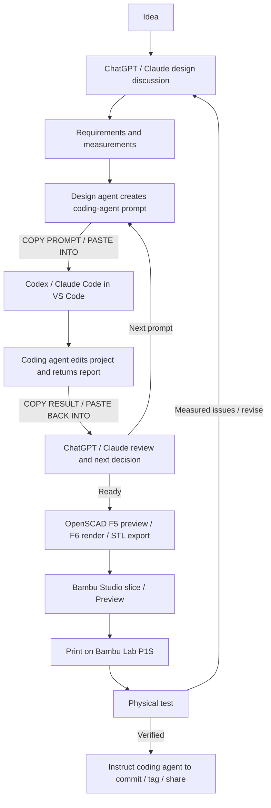
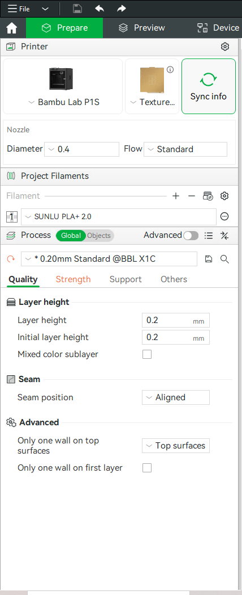

# maker-share

## 1. Overview

maker-share is a shared workspace for designing, developing, sharing, and printing 3D maker projects. Start with a measured problem, make a focused change, and record what actually worked on the printer.

**ChatGPT or Claude is your design agent:** discuss what to build and review results there. **Codex or Claude Code is your coding agent:** it changes project files in Visual Studio Code and handles Git/GitHub operations when instructed. OpenSCAD holds the 3D model; Bambu Studio prepares prints for the Bambu Lab P1S.

**Already comfortable with ChatGPT/Claude, Codex/Claude Code, VS Code, and agent-driven Git? Jump to the [TL;DR: OpenSCAD to P1S Fast Path](#tldr-openscad-to-p1s-fast-path).**

You are the bridge between the two agents:

1. Discuss your idea with ChatGPT or Claude. Supply measurements, photos, constraints, and desired behavior, then work through the design together.
2. When ready, ask the design agent to create a prompt for Codex or Claude Code. You generally do not need to invent implementation prompts yourself.
3. **Copy the entire prompt and paste it into the coding agent** running in your local copy of the GitHub repository. Let it make the requested changes, verify what it can, and return a concise report.
4. **Copy the coding agent's report and paste it back into the design-agent conversation.** Review the result together and decide the next step.
5. Repeat with the next prompt as needed, then render, slice, print, and physically test. Bring measured print results back to the same design conversation.



For your first prototype, follow setup in Sections 3 and 5, gather inputs in Section 4, and use Section 6 at the printer.

## TL;DR: OpenSCAD to P1S Fast Path

For experienced AI/coding collaborators who already use VS Code and agent-driven Git/GitHub, but are new to OpenSCAD, Bambu Studio, and the P1S. Install OpenSCAD and Bambu Studio using the [tools table](#3-tools-and-installation) if needed, then follow this path from design conversation to first prototype.

1. **Design the part with ChatGPT or Claude.** Discuss the physical problem and provide measured dimensions, photos, constraints, and desired behavior. Resolve important fit/clearance questions, then ask the design agent for a focused implementation prompt. Use real measurements for fitted objects rather than guessing from photos.

2. **Send the prompt to Codex or Claude Code.** Start it from the repository/project root; at the beginning of a new session, have it read [AGENT.md](AGENT.md). Paste the design-agent prompt and have it create or modify the project's OpenSCAD `.scad` source while preserving unrelated geometry. Ask it to verify what it can and return a concise report; copy that report back to the design agent for review and the next decision.

3. **Review the OpenSCAD model.** Open the `.scad` file in OpenSCAD and leave it open while the coding agent works so you can review saved changes. Refresh if changes are not shown automatically. **F5 = fast preview**, which may show visual artifacts; **F6 = final, authoritative render before export**. Visually check important features and compare the relevant dimensions with your measurements.

4. **Export STL after a successful F6 render.** Choose **File → Export → Export as STL** and save into the project's `exports/` folder. If explicitly asked and able to do so, the coding agent may generate and verify this export instead. **SCAD is editable design source; STL is the geometry file for the slicer.** Resolve render errors before exporting.

5. **Open Bambu Studio and import the verified STL.** Select **Bambu Lab P1S**, confirm the installed nozzle and filament/profile, and orient the part for strength and minimum support. For simple PLA/PLA+ prototypes, start with a **0.4 mm nozzle, 0.20 mm layer height, 3 wall loops, 15–20% sparse infill, and supports off unless needed**. These are starting points, not universal settings; the selected profile must match the actual nozzle and filament.

6. **Slice and inspect.** Click **Slice plate**, then inspect **Preview**. Check first layers, holes, thin walls, bridges, overhangs, supports, and important fitted features. Review the sliced layers before sending the job; the solid model view alone does not show the actual print paths.

7. **Send to the printer.** Send the reviewed job to the **Bambu Lab P1S**, confirm the destination printer and material mapping as needed, and print. Check that the intended filament is loaded rather than relying only on the project filename or profile name.

8. **Test the real part.** Check fit, clearances, mounting, flex, warping, access/insertion/removal, and print quality. Bring measured problems and photos back to the design-agent conversation, ask for the next coding-agent prompt, and repeat until verified. A successful CAD render does not establish physical fit or strength.

9. **Save the proven print setup.** Once a print is proven, save a Bambu Studio project such as `model-p1s-print.3mf`: unlike the STL geometry export, this project includes orientation and slicer settings. For repeat prints, reopen the known-good 3MF → confirm printer/nozzle/filament → slice → Preview → print. If the SCAD source changes, update matching exports and recheck the setup before treating that project as current.

If this process is clear, use this section as your normal fast path. For step-by-step help, see [Section 5: VS Code and coding-agent workflow](#5-vs-code-and-coding-agent-workflow), [Section 6: OpenSCAD to Bambu Studio to print](#6-openscad-to-bambu-studio-to-print), or [Section 7: Git and GitHub with the coding agent](#7-git-and-github-with-the-coding-agent).

## 2. Printer and filament

Our normal printer is the [Bambu Lab P1S](https://us.store.bambulab.com/products/p1s).

| Feature | Working context |
| --- | --- |
| Build volume | 256 x 256 x 256 mm |
| Motion and enclosure | Enclosed CoreXY |
| Standard nozzle | 0.4 mm |
| Optional nozzles | 0.2 / 0.6 / 0.8 mm |
| Maximum hotend temperature | 300 °C |
| Common supported materials | PLA, PETG, TPU, ABS, ASA |
| Slicer | Works directly with Bambu Studio |

Use the 0.4 mm nozzle for general work. A 0.2 mm nozzle helps with fine lettering and small details; other nozzle and material choices depend on the project. Confirm the installed nozzle before choosing a slicer profile.

Start with [Bambu Lab PLA Basic](https://us.store.bambulab.com/products/pla-basic-filament), a 1.75 mm, easy general-purpose filament suited to prototypes. Other quality PLA or PLA+ brands are fine with suitable filament profiles. Record the actual material used when judging fit or strength so another collaborator can reproduce the result.

## 3. Tools and installation

| Tool | Purpose | Windows link |
| --- | --- | --- |
| ChatGPT | Discuss requirements and design | [Open ChatGPT](https://chatgpt.com/) |
| Claude | Discuss requirements and design | [Open Claude](https://claude.ai/) |
| Visual Studio Code | Edit source and run coding agents | [Download](https://code.visualstudio.com/) |
| Git for Windows | Version control and sharing | [Install](https://git-scm.com/download/win) |
| OpenSCAD | Preview, render, and export models | [Download](https://openscad.org/downloads.html) |
| Bambu Studio | Orient, slice, preview, and print | [Download](https://bambulab.com/en/download/studio) |
| Claude Code | Implement focused GitHub repository tasks | [Setup documentation](https://docs.anthropic.com/en/docs/claude-code/getting-started) |
| Codex | Implement focused GitHub repository tasks | [Official IDE documentation](https://developers.openai.com/codex/ide) |

Install Git, VS Code, OpenSCAD, and Bambu Studio using the links above. Section 5 walks through the extension, coding-agent, and repository setup.

OpenSCAD **2021.01** and Bambu Studio **02.08.02.61** have been used successfully. Newer stable versions are generally acceptable; no downgrade is required.

## 4. Design workflow

Start a conversation in ChatGPT or Claude to decide **what should be built** before files change. Describe the problem and possible shapes, then collect these inputs with the design agent:

| Input | Useful detail |
| --- | --- |
| Dimensions | Measured sizes, units, and which surfaces they describe |
| Photos or sketches | Views showing the fitted object and available space |
| Fit and clearance | Sliding, loose, snug, or removable; clearance per side or total |
| Mounting and hardware | Screw sizes, hole spacing, attachment method |
| Access | How the object enters, leaves, and is handled |
| Printing | Intended material, nozzle, and whether supports are acceptable |
| Use conditions | Indoor/outdoor, heat exposure, loads, and strength needs |
| Appearance | Visible faces, lettering, finish, and preferred orientation |

**Measure real fitted objects whenever possible.** A nominal product size or a photo without scale is a poor substitute for the dimension that controls fit. Mark unknowns explicitly so the agent can ask about them.

The device-holder measurements, paths, and test results in the examples below are illustrative; replace them with your project's actual details. Replace `<username>` with your Windows username.

Agree on a testable outcome: for example, “the holder accepts the measured device and lets it slide out without removing the mounting screws.” If fit is uncertain, ask about a small fit sample before the full part. Once the constraints are settled, ask the design agent for the first coding-agent prompt.

<details>
<summary>Example prompt</summary>

```text
Help me design a removable wall-mounted holder for the device in these photos.

Approximate measurements:
- width: 42 mm
- height: 85 mm
- depth: 24 mm

Mounting:
- two #6 screws
- mounted vertically on a wall
- screw heads should not interfere with the device

Use:
- light load, under 0.5 kg
- indoor or sheltered outdoor use
- may see temperatures up to about 45 C / 113 F
- device should slide in from the top
- front display should remain visible
- device should be easy to remove without removing the wall screws

Print setup:
- Bambu Lab P1S
- 0.4 mm nozzle
- PLA
- supports should be avoided if practical

Please identify any missing measurements or design decisions before modeling, and tell me whether a small fit-test piece would be useful.

Once we agree on the design, create a focused Codex/Claude Code prompt that includes:
- the agreed dimensions
- required clearances
- mounting details
- features that must remain unchanged
- verification steps
- STL/export requirements

Do not ask the coding agent to commit or push yet.
```

</details>

## 5. VS Code and coding-agent workflow


*Reference: VS Code with the cradle source open and a coding-agent Git status report alongside it.*

### First time

1. Install VS Code and Git for Windows using Section 3.
2. Open VS Code, click the **Extensions** icon on the left sidebar (or press **Ctrl+Shift+X**), search for **OpenSCAD Language Support** by **Leathong**, and click **Install**. This is our known working OpenSCAD extension.
3. Install/configure Codex and/or Claude Code using its linked setup instructions, including sign-in.
4. Ask the coding agent to clone the maker-share GitHub repository into your chosen local project folder; provide its URL from GitHub. If you already have a local copy, use that copy.
5. Choose **File → Open Folder** and open the root folder of your **local copy of the GitHub repository**, not a broad parent directory. Run the coding agent from that root.

<details>
<summary>Example prompt</summary>

```text
Set up the maker-share GitHub repository on this Windows PC.

GitHub repository:
git@github.com:lairdrt/maker-share.git

Use this local folder:
C:\Users\<username>\Documents\Projects\maker-share

If the folder does not exist, clone the repository there.
If it already exists, do not overwrite it; check that it is the correct maker-share repository.

When finished, tell me:
- the local repository path
- the current branch
- whether origin points to the maker-share GitHub repository
- whether the working tree is clean

Do not modify project files, commit anything, or push anything.
```

</details>

### Each work session

1. Start in the ChatGPT or Claude design conversation. Work out the model or change needed, then ask for a Codex/Claude Code prompt.
2. Copy the entire prompt and open the coding agent in VS Code with maker-share open.
3. At the start of a new coding-agent session, tell it: **“Read AGENT.md, then execute the following task.”** Paste the design-agent prompt.
4. Ask the coding agent to check Git status and pull the latest changes before editing (Section 7). Have it report existing changes or conflicts before proceeding.
5. Let it inspect only relevant files and implement the requested change. Keep OpenSCAD open to review saved model changes as it works.
6. Let it perform requested verification and review the relevant Git diff. Read its final report, including checks it could not perform.
7. Copy that report and paste it back into ChatGPT or Claude. Include your observations or screenshots if the model looks wrong.
8. Discuss the result with the design agent. Copy/paste its next prompt if another change is needed, or proceed to rendering and printing in Section 6.

[AGENT.md](AGENT.md) defines implementation rules. The collaborator carries prompts and reports between the agents; the coding agent does not automatically share its results with the design conversation. Resolve new design decisions with the design agent before expanding implementation scope.

Ask the design agent to include the goal, target file, dimensions, what must stay unchanged, verification, export requirements, and Git authorization in each prompt.

<details>
<summary>Example prompt</summary>

```text
Read AGENT.md first.

Please update projects/device-holder/src/model.scad.

The device is 42.0 mm wide. I want 0.3 mm clearance on each side,
so make the inside width 42.6 mm.

Keep the outside width, base thickness, mounting holes, overall height,
and all other dimensions unchanged. Tell me if these requirements conflict.

Render the model with OpenSCAD and check the new inside width.
Do not update the STL or other exports yet. Do not commit or push.
Tell me what changed and what you were able to check.
```

</details>

Review fixed features too: a plausible-looking model can still have an incorrect clearance or shifted mounting hole.

<details>
<summary>Example prompt</summary>

```text
Here is the report from Codex/Claude Code:

[paste the report here]

I also looked at the model in OpenSCAD.
Please review the result against the design we agreed on.
Tell me which checks are still needed.
If something needs to change, explain what and give me the next prompt
to paste into the coding agent. If it looks ready to print, tell me the next steps.
```

</details>

## 6. OpenSCAD to Bambu Studio to print

### Edit, preview, render, export


*Reference: OpenSCAD preview of the cradle model. Use F6 for the final render before export.*

1. Let the coding agent create or modify the project's `.scad` file, normally the design source of truth.
2. Open that file in OpenSCAD and keep it open while the agent works. Refresh saved changes if automatic reload is disabled.
3. Use **F5** for fast preview while developing. It may show visual artifacts.
4. Use **F6** for the final, authoritative OpenSCAD render before export. Resolve render errors before proceeding.
5. Visually inspect important geometry, especially fitted surfaces, holes, and features changed by the task. Compare dimensions with the agreed measurements.
6. Once verified, use **File → Export → Export as STL** and save into the project's `exports/` folder. If able and instructed, the coding agent may generate and verify the export instead.

The coding agent should keep important dimensions easy to identify and avoid changing parts of the model that already work. A successful render can still have the wrong size or fit; compare important dimensions with the real object before printing.

Use a clear export filename. Geometry-only 3MF exports can also carry a mesh, but they do not automatically contain a prepared Bambu Studio print setup.

<details>
<summary>Example prompt</summary>

```text
Please check the current OpenSCAD model in:
projects/device-holder/src/model.scad

Render it using the final OpenSCAD render.
Please check:
- the inside width is 42.6 mm
- the two mounting holes are still in the same locations
- the model is a valid printable solid

If everything checks out, export the STL to:
projects/device-holder/exports/model.stl

Do not change other files or commit or push anything yet.
Tell me what you checked, what you could not check, and whether the export succeeded.
```

</details>

### Prepare the print in Bambu Studio


*Reference: Bambu Studio's Prepare view. Confirm your own printer, nozzle, filament, and process settings before slicing.*

1. Open Bambu Studio.
2. Import the verified STL, or open an existing known-good `*-p1s-print.3mf`.
3. Confirm printer = **Bambu Lab P1S**.
4. Confirm the profile matches the installed nozzle.
5. Confirm the loaded filament and selected filament profile match.
6. Confirm model orientation for strength and minimum support.
7. Confirm starting print settings using the table below.
8. Click **Slice plate**.
9. Open **Preview** and inspect layers, holes, bridges, overhangs, thin features, and supports.
10. Send the reviewed print to the printer and print it.
11. Inspect the real printed part using the physical checks below.
12. Report measured fit and issues back to the design-agent conversation.

For simple PLA prototypes, use these initial settings:

| Setting | Starting point |
| --- | --- |
| Printer / nozzle | Bambu Lab P1S / 0.4 mm |
| Filament | PLA / PLA+ with a suitable profile |
| Layer height | 0.20 mm |
| Wall loops | 3 |
| Sparse infill | 15–20% |
| Supports | Off unless needed |
| Orientation | Favor strength and minimum support |

**These are starting points, not universal settings.** Adjust for the part's function and inspect Preview again, especially fitted surfaces and mounting features.



*Bambu Studio starting-point settings for the P1S. Confirm printer, installed nozzle, filament profile, and process settings before slicing; the pictured preset name includes “X1C”.*

### Save a repeatable print project

**SCAD** is editable design source; **STL** is geometry sent to the slicer; a **Bambu project 3MF** is a saved ready-to-print project with orientation and slicer setup. After a print is proven, save a project such as `model-p1s-print.3mf` alongside its matching export.

For repeat prints: open the known-good `*-p1s-print.3mf` → confirm printer/nozzle/filament → slice → Preview → print. If the source changes, update the geometry and recheck the setup before treating the saved project as current.

### Physically verify

A model is not fully proven because it looks correct in CAD. Test the printed part for:

- Fit, clearances, hole sizes, and mounting alignment.
- Flex, warping, and suitability for the intended load.
- Insertion, removal, and access to hardware.
- Bridges, overhangs, and surface quality.

Tell the design agent the material, relevant print settings, result, and useful photos. Describe failures with measurements, such as “pocket is 0.4 mm too narrow,” so it can create the next coding-agent prompt. Distinguish “rendered,” “sliced,” and “physically tested” when sharing progress.

<details>
<summary>Example prompt</summary>

```text
I printed the example holder on a Bambu Lab P1S using PLA,
a 0.4 mm nozzle, and 0.20 mm layers.

The sensor slides in, but the pocket is 0.4 mm too narrow for easy removal.
The mounting holes and base work well. Photos attached.

Help me decide what to change and give me the next coding-agent prompt.
Keep the working mounting holes and base unchanged.
Ask for any missing measurements before deciding the new inside width.
```

</details>

## 7. Git and GitHub with the coding agent

Git keeps local version history; GitHub holds the shared remote copy. A commit records a version locally, and a push shares it. Install [Git for Windows](https://git-scm.com/download/win), then normally **tell Codex or Claude Code to perform Git operations**. Routine command-line Git work is not required.

For first-time setup, normally paste the setup prompt below; you do not need to configure Git manually. Codex or Claude Code can clone maker-share, create or check the local folder, configure or check `origin`, verify that `main` tracks `origin/main`, pull safely, and report final status.

<details>
<summary>Copy/paste: set up maker-share on this Windows PC</summary>

```text
Please set up the maker-share GitHub repository on this Windows PC.

GitHub repository:
git@github.com:lairdrt/maker-share.git

Please put the local copy here:
C:\Users\<username>\Documents\Projects\maker-share

Please handle the Git setup for me.
Before making changes:
- check that Git is installed; if not, stop and ask me to install Git for Windows
- check whether the maker-share folder already exists
- do not overwrite anything that is already there

If the folder does not exist, clone maker-share into that location.
If it already exists, check that it is the correct maker-share repository.

Then:
- make sure the current branch is main; if it is different, stop and tell me
- make sure origin points to the GitHub repository above
- make sure main is connected to origin/main
- pull the latest version only if the working folder is clean and it is safe
- do not change project files, commit, or push anything

At the end, tell me:
- where the local repository is
- which branch I am on and the origin URL
- whether main is connected to origin/main
- whether it is up to date with GitHub
- whether the working folder is clean

Do not rewrite history or delete or overwrite an existing folder.
If you find a conflict or something unexpected, stop and tell me before changing anything.
```

</details>

Once the GitHub repository is set up, routine GitHub work can normally be handled entirely by the coding agent. After a design has been verified, normally paste the save-to-GitHub prompt below.

<details>
<summary>Copy/paste: save the current maker-share work to GitHub</summary>

```text
The current maker-share work has been reviewed and is ready to save to GitHub.
Please handle all of the Git/GitHub work for me from the main maker-share folder.

Before committing:
- read AGENT.md and follow its Git rules
- check Git status
- review all changed, new, and deleted files anywhere inside maker-share
- make sure the files belong to maker-share
- do not include temporary, editor, cache, or build files, passwords, tokens,
  credentials, private computer settings, or unrelated files
- make sure referenced README images and project files are present
- if an OpenSCAD model changed and this is a printable version,
  make sure its matching exports are current
- show me a short summary of what will be committed

Then:
- stage all intended maker-share files, including new files and intended deletions
- do not leave out new files that belong to maker-share
- do not include files from outside the maker-share folder
- create a short descriptive commit message
- commit the changes and push the current branch to origin on GitHub

After the push, check:
- the working tree is clean
- the local branch matches its GitHub branch; for main, local main matches origin/main
- all intended files are on GitHub
- no intended maker-share files are left untracked

Do not rewrite history or move or replace existing version tags.
Only delete something from GitHub if its local deletion was intentional.

At the end, tell me:
- what files were added, changed, or deleted
- the commit message and commit hash
- whether the push succeeded
- the final Git status and whether local and GitHub are in sync
- whether all intended maker-share files are on GitHub
```

</details>

### Optional: what the coding agent is doing

You normally do not need to run these commands or use these smaller prompts yourself.

The underlying workflow is **Pull → Work → Verify → Commit → Push**. The coding agent checks status, pulls, inspects diffs, stages relevant files, commits, pushes, and verifies the result.

<details>
<summary>Example prompts</summary>

Use the instruction that matches the current step:

```text
Please check Git status for maker-share.
Tell me whether the working folder is clean and local main is up to date
with origin/main on GitHub. Do not change anything.
```

```text
Please check maker-share for local changes, then pull the latest origin/main.
If there are local changes or conflicts, stop and tell me before continuing.
Do not discard work or commit anything.
```

```text
Please review and commit only the README.md changes from this task.
Use a short descriptive message and push to origin/main.
Leave any other work unchanged. Check that the README changes reached GitHub,
local main matches origin/main, and report any files still changed or untracked.
Do not create or move tags.
```

</details>

Have the agent report existing changes or conflicts before pulling or editing, preserve unrelated work, and review the relevant diff before committing. It must wait for explicit instructions to commit or push; the design agent can include those instructions in a prompt once you decide the work is ready to share.

Optional command reference—these are the operations the agent handles, not a script you need to run:

```text
git pull    # Bring in shared changes
git status  # Show changed files
git diff    # Inspect edits
git add     # Stage specified task files
git commit  # Record a version
git push    # Share committed work
```

Important known-good designs may receive tags such as `v1.0`, `v2.0`, or `v3.0` to mark meaningful baselines. Ask the coding agent to create/share a tag when appropriate and identify which project/version it represents. Do not casually move an existing tag because documentation or photos change later.

<details>
<summary>Example prompt</summary>

```text
Please mark the verified maker-share commit I identify below as device-holder-v1.0
and push that tag to origin.

[paste the verified commit hash here]

If that tag already exists locally or on GitHub, stop and tell me.
Do not move any existing tag. Check that the GitHub tag points to this commit.
```

</details>

## 8. Project structure and collaboration rules

Use this general structure as projects are added; it is a recommendation, not a list of folders already created:

```text
maker-share/
  README.md
  AGENT.md
  projects/
    project-name/
      src/
        model.scad
      exports/
        model.stl
        model-p1s-print.3mf
      photos/
      reference/
      README.md
  docs/
  reference/
```

`.scad` is editable source; `.stl` is exported geometry; `*-p1s-print.3mf` denotes a known-good Bambu print project. Keep project-specific measurements and references with the project. Use root `docs/` and `reference/` for shared material.

Project documentation may capture useful measurements and results; ask the design agent to include it in a prompt when useful. Routine README maintenance is not expected. Flag stale exports or unprinted designs in reports.

<details>
<summary>Example prompt</summary>

```text
Please create a coding-agent prompt to update:
projects/device-holder/README.md

Use these example test results:
- printed on a Bambu Lab P1S with PLA and a 0.4 mm nozzle
- 0.20 mm layers, 3 wall loops, 15% infill, no supports
- inside width is 42.6 mm for a 42.0 mm device
- the sensor slides in and out easily and the mounting holes line up
- the STL matches this version; no Bambu Studio project has been saved yet

Keep the model and exports unchanged. Describe only the checks actually done.
Do not ask the coding agent to commit or push.
```

</details>

- Ask the coding agent to pull before starting and work on one focused task at a time.
- Coordinate before modifying another collaborator's project.
- Preserve known-good versions and existing tags.
- Keep source and exports synchronized when publishing a printable revision; identify intentionally deferred exports.
- Have the coding agent review Git status/diff, use clear commit messages, and push completed work when authorized.
- Include measurements/photos for fitted-part requests and physically verify important designs.

Measure real objects. Make dimensions explicit. Use 3D models. Change one thing at a time. Render before exporting. Slice before printing. Physically test before declaring success. Keep known-good versions in Git.
